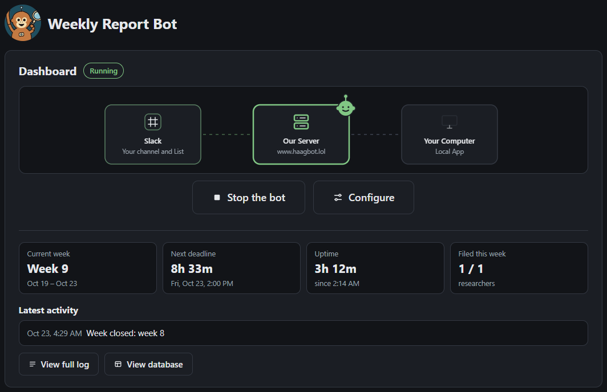
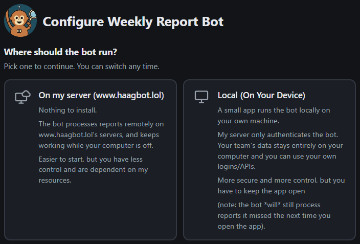
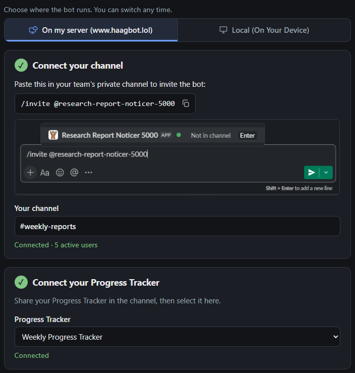
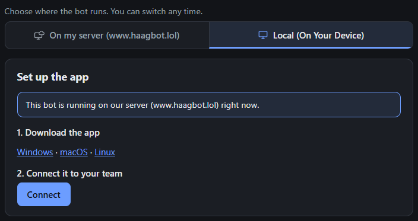

# Research Report Noticer 5000

This bot watches a Slack channel for weekly research reports and fills in a Progress Tracker (a Slack List).

When a researcher posts a PDF or DOCX in the channel, the bot:

1. Decides whether it is a weekly report.
2. Works out which week it covers.
3. Writes that researcher's row for the week: status, summary, blockers and links to their GitHub work.
4. Optionally reacts to the post with an emoji.

At the Friday deadline it marks anyone who didn't post as **No Report**, and can DM them a reminder. Edits people make in the List are kept. Summaries and links can come from an LLM or be left for you to fill in.

## How the Bot Works

The bot maintains an internal SQLite database and syncs it with the slack list.

Each step can be configured to run on plain rules or use an LLM if you're even lazier.

| Step | Without an LLM | With an LLM |
|---|---|---|
| Is it a report? | **Regex Match**: the bot reads a list of rules you supply it and responds to any match| Judged against an editable prompt, fed each researcher's past reports as a guide |
| Which week? |  **Regex Match** `Week N` by default, otherwise the post date | Read from the report along with the summary |
| Status, summary, blockers | Left for you to fill in | Written by the LLM |
| Link to Work | Left for you to fill in | Matched to the researcher's GitHub pull requests based on the summary |

## You need

- **An invite link.** The operator sends it as a Slack DM. It works once and expires after 7 days.
- **A private Slack channel** where researchers post their reports.
- **A Slack List** shared in that channel, with the columns below.

## Progress Tracker Schema

Column names don't have to match. Setup guesses which column is which from its name, and you can assign them during setup.

| Column | Required | Type | What the bot writes |
|---|---|---|---|
| Week | Yes | Text | `Week 5 (9/28 - 10/2)` |
| | | Date | A date in that week, on the weekday your existing rows use (Friday if none) |
| Researcher | Yes | Person | The researcher who posted |
| | | Text | Their Slack name, matched exactly when read back |
| Summary | Yes | Text | One point per line |
| Blockers | Yes | Text | One per line, or `N/A` |
| Status | Yes | Select | One of your options. Needs a **No Report** option |
| | | Text | `On Track`, `Blocked`, `Unclear` or `No Report` |
| Confirmed | No | Checkbox | Unticked on a new row, then only read |
| Link to Work | No | Text | Links to the matching work, one per line, or `N/A` |

No other column types are allowed.

Slackbots can't add, alter, or delete columns from a list (only rows). If a required column is missing or has the wrong type, you will need to fix it by hand first.

## Pick where it runs

Open the invite link and choose:

| | On our server | Local app |
|---|---|---|
| Install | Nothing | The app, for Windows, macOS or Linux |
| Runs while your computer is off | Yes | No, but catches up when the app opens |
| Your team's data | On another user's server | On your computer |
| LLM APIs | The ones the server offers | Your own logins, or a local model |

You can switch between these any time.

## On our server

1. Choose **On my server** during setup.
2. Paste `/invite @research-report-noticer-5000` in your channel.
3. Select your Progress Tracker and check that the schema matches.
4. Add researchers, then set up Processing, Schedule and Reactions.
5. Click **Save and start**.

## Local app

1. Choose **Local**.
2. [Download the app](https://github.com/Orangutanthony/Research-Report-Noticer-5000/releases/latest) and run it.
3. Click **Connect**.
4. Fill in the same steps in the app and click **Save and start**.

The app keeps running in the system tray after you close its window.

## After

Go back to https://haagbot.lol/setup/ in the same browser, or open the app, to see the dashboard. Here you can stop and start the bot on either location, see this week's stats, the activity log and the internal SQLite database. **Configure** changes settings.
